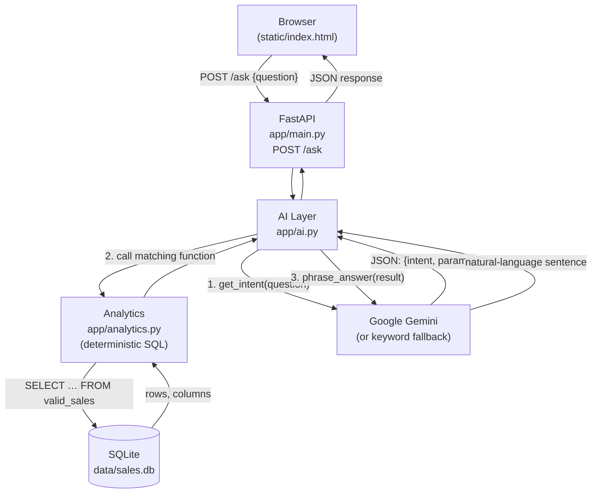

# Mini AI BI Assistant

A lightweight Business Intelligence assistant where users ask natural-language questions about sales data and receive answers backed by real SQL query results.

> **Interview note**: Every design decision in this codebase is commented at the point where it's made. Start with `app/db.py` → `app/analytics.py` → `app/ai.py` → `app/main.py`.

---

## Architecture



**Key principle**: The LLM interprets and phrases; the database calculates. Numbers in the answer are always verified against the actual SQL result.

---

## How Data Is Stored and Queried

### Tables & Views

| Name            | Description |
|-----------------|-------------|
| `sales`         | All accepted rows (including Returned). `revenue` column pre-computed at load time as `quantity × unit_price − discount_amount`. |
| `rejected_rows` | Rows that failed validation, with a human-readable `reason` column. |
| `valid_sales`   | **VIEW** — `SELECT * FROM sales WHERE status = 'Completed'`. All analytics queries target this view so Returned rows are automatically excluded. |

### Revenue definition
`revenue = quantity * unit_price - discount_amount`

`discount_amount` is treated as a **line-level total discount in currency units** (not a percentage). This is documented in `app/db.py`.

### Data quality rules (applied at load time)
| Condition | Outcome |
|-----------|---------|
| `quantity <= 0` | → `rejected_rows` |
| `unit_price` missing or non-numeric | → `rejected_rows` |
| `discount_amount < 0` | → `rejected_rows` |
| `order_date` not parseable as DD-MM-YYYY | → `rejected_rows` |
| `status = 'Returned'` | → `sales` table, excluded from `valid_sales` |

---

## How Unsupported / Incorrect Answers Are Prevented

1. **Intent validation**: The LLM must return one of five declared intents. Unknown intents are rejected by Pydantic before any query runs.
2. **SQL validator** (guarded text-to-SQL path):
   - `sqlglot` parses the SQL; only a single plain `SELECT` is allowed.
   - Keyword blocklist: `INSERT`, `UPDATE`, `DELETE`, `DROP`, `ALTER`, `ATTACH`, `PRAGMA`.
   - Table whitelist: only `valid_sales`.
   - `LIMIT` injected if missing.
   - Executed on a **read-only SQLite connection** (`?mode=ro`) as a second line of defence.
3. **Number-check**: Every number in the LLM's answer sentence must appear in the actual result rows. If not, a templated sentence is used instead.
4. **Keyword fallback**: If the Gemini API is unavailable, a deterministic keyword router handles the five intents so the app never crashes.

---

## Setup

### Prerequisites
- Python 3.11+
- A `GEMINI_API_KEY` environment variable (optional — app works offline without it)

### Install dependencies

```bash
pip install -r requirements.txt
```

### Load data

```bash
python scripts/load_data.py
```

Expected output:
```
=======================================================
  DATA LOAD SUMMARY
=======================================================
  CSV file        : data/sales.csv
  Rows loaded     : 49
  Rows rejected   : 2
  Rows returned   : 1  (stored, excluded from revenue)
-------------------------------------------------------
  REJECTED DETAILS:
    [TXN0034] Quantity must be > 0; got 0
    [TXN0051] Missing Unit_price
  RETURNED TRANSACTIONS (in sales, not in valid_sales view):
    [TXN0033]
=======================================================
```

### Run the server

```bash
python -m uvicorn app.main:app --reload
```

Open [http://localhost:8000](http://localhost:8000) in your browser.

### Run tests

```bash
pytest -v
```

---

## Example curl Calls

```bash
# Health check
curl http://localhost:8000/health

# Data summary
curl http://localhost:8000/data-summary

# Total revenue
curl -X POST http://localhost:8000/ask \
  -H "Content-Type: application/json" \
  -d '{"question": "What is the total revenue?"}'

# Top product
curl -X POST http://localhost:8000/ask \
  -H "Content-Type: application/json" \
  -d '{"question": "Which product generated the highest revenue?"}'

# Monthly trend
curl -X POST http://localhost:8000/ask \
  -H "Content-Type: application/json" \
  -d '{"question": "What is the monthly revenue trend?"}'

# Top region
curl -X POST http://localhost:8000/ask \
  -H "Content-Type: application/json" \
  -d '{"question": "Which region generated the highest sales?"}'

# Month-to-month change
curl -X POST http://localhost:8000/ask \
  -H "Content-Type: application/json" \
  -d '{"question": "How did revenue change between 2026-01 and 2026-02?"}'
```

---

## Known Limitations

- **Single-table analytics only**: All five supported intents query `valid_sales`. Multi-table joins are not supported.
- **Date range filtering**: The `revenue_change_between_months` function uses exact month strings; partial ranges are not supported.
- **Text-to-SQL fallback is basic**: The keyword client's `generate_sql` just returns `SELECT * FROM valid_sales LIMIT 10` — not a real query generator. With a real API key, Gemini handles this properly.
- **No authentication**: The API has no auth layer — not production-grade.
- **SQLite only**: Not designed for concurrent writes or large datasets.
- **Gemini model version**: Uses `gemini-2.0-flash`. The model name may need updating as the API evolves.
