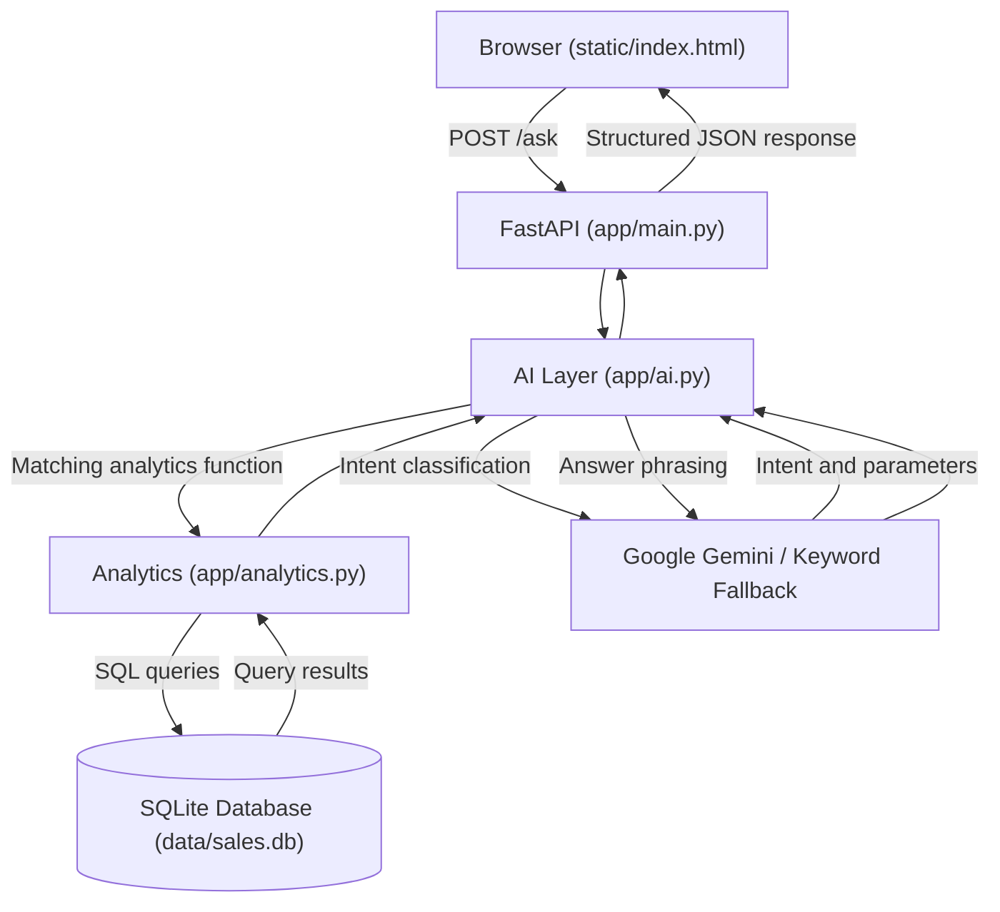

# Mini AI BI Assistant

A lightweight Business Intelligence assistant where users can ask natural-language questions about sales data and receive answers backed by actual SQL query results.

**Project:** RSG – AI-Assisted Development Challenge for GET Selection

## Architecture



**Key principle:** The AI interprets the question and helps phrase the answer. SQLite performs the actual business calculations. The application also checks generated answer numbers against query results.

## How Data Is Stored and Queried

### Database tables and views

| Name | Description |
|---|---|
| `sales` | Stores all accepted transactions, including returned transactions. |
| `rejected_rows` | Stores invalid records along with their original data and rejection reasons. |
| `valid_sales` | SQLite view containing only transactions with `status = 'Completed'`. |

### Revenue calculation

```python
revenue = quantity * unit_price - discount_amount
```

The discount amount is treated as a line-level total discount in currency units, not a percentage.

### Data validation rules

| Condition | Outcome |
|---|---|
| Quantity <= 0 | Rejected |
| Missing or non-numeric unit price | Rejected |
| Negative discount amount | Rejected |
| Invalid order date | Rejected |
| Returned transaction | Stored in sales but excluded from revenue calculations |

The supplied dataset contains 51 records.

Expected data loading summary:

- 49 accepted records
- 2 rejected records
- 1 returned transaction
- 48 completed valid transactions

## Analytics Supported

The application supports all five example questions provided in the assignment:

1. What is the total revenue?
2. Which product generated the highest revenue?
3. What is the monthly revenue trend?
4. Which region generated the highest sales?
5. How did revenue change between two months?

All five analytics functions are implemented using deterministic SQL queries in `app/analytics.py`.

## How Unsupported or Incorrect Answers Are Prevented

1. **Intent validation:** The AI response is validated against the supported intent schema. Unknown intents are treated as unsupported.

2. **SQL validation:** The secondary text-to-SQL path uses SQLGlot to parse and validate generated SQL.
   - Only a single SELECT statement is allowed.
   - Destructive operations such as INSERT, UPDATE, DELETE, DROP, ALTER, ATTACH and PRAGMA are blocked.
   - Only the whitelisted `valid_sales` view is allowed.
   - A LIMIT is added when missing.
   - Queries execute using a read-only SQLite connection.

3. **Answer verification:** Numbers in the AI-generated answer are checked against actual query results. If unsupported numbers are detected, a template-based answer is used.

4. **Keyword fallback:** If the Gemini API key is missing or Gemini client initialization fails, the application uses a keyword-based fallback for supported analytics questions.

5. **Error handling:** Invalid requests, unsupported questions and query errors are handled through structured API responses.

## Setup and Execution

### Prerequisites

- Python 3.11 or later
- pip
- Google Gemini API key (optional)

### 1. Clone the repository

```bash
git clone https://github.com/sricharnitha13/rsg-ai-business-intelligence-assistant.git
cd rsg-ai-business-intelligence-assistant
```

### 2. Create a virtual environment

**Windows:**

```bash
python -m venv .venv
.venv\Scripts\activate
```

### 3. Install dependencies

```bash
pip install -r requirements.txt
```

### 4. Configure Gemini API (optional)

For Gemini-powered question interpretation, configure your API key.

**Windows Command Prompt:**

```cmd
set GEMINI_API_KEY=YOUR_GEMINI_API_KEY
```

**PowerShell:**

```powershell
$env:GEMINI_API_KEY="YOUR_GEMINI_API_KEY"
```

The application can run without an API key using the keyword-based fallback.

Never commit your actual API key to GitHub.

### 5. Load the sales dataset

```bash
python scripts/load_data.py
```

Expected output:

```text
=======================================================
  DATA LOAD SUMMARY
=======================================================
  Rows loaded     : 49
  Rows rejected   : 2
  Rows returned   : 1
-------------------------------------------------------
  REJECTED DETAILS:
    [TXN0034] Quantity must be > 0; got 0
    [TXN0051] Missing Unit_price
-------------------------------------------------------
  RETURNED TRANSACTIONS:
    [TXN0033]
=======================================================
```

### 6. Start the application

```bash
python -m uvicorn app.main:app --reload
```

Open the application in your browser:

http://localhost:8000

API documentation:

http://localhost:8000/docs

### 7. Run automated tests

```bash
pytest -v
```

The project contains 36 automated test functions covering API endpoints, analytics, AI interpretation, SQL validation and edge cases.

## API Endpoints

| Method | Endpoint | Description |
|---|---|---|
| GET | `/` | Opens the web interface |
| GET | `/health` | Checks application health |
| GET | `/data-summary` | Displays database loading statistics |
| POST | `/ask` | Accepts natural-language questions |

### Example API Request

**Endpoint:**

```text
POST http://localhost:8000/ask
```

**Request body:**

```json
{
  "question": "What is the total revenue?"
}
```

The API returns a structured response containing:

- Question
- Natural-language answer
- Detected intent
- Executed SQL query
- Result columns
- Supporting data rows
- Processing path used

## Example Questions

Try asking these questions through the web interface:

- What is the total revenue?
- Which product generated the highest revenue?
- Show monthly revenue trends.
- Which region generated the highest sales?
- How did revenue change between 2026-01 and 2026-02?

## Testing

Automated tests are organized into three files:

| Test file | Coverage |
|---|---|
| `tests/test_ai.py` | AI fallback, SQL validation and answer verification |
| `tests/test_analytics.py` | Revenue calculations, product ranking, monthly trends and regional analytics |
| `tests/test_api.py` | API endpoints, invalid inputs, unsupported questions and edge cases |

Tests use a temporary SQLite database and a keyword fallback client, so a live Gemini API key is not required.

## Known Limitations

- **Limited intent recognition:** The keyword fallback recognizes predefined phrases and may not understand every variation of a question.
- **Month comparison:** Revenue comparison requires two identifiable months in YYYY-MM format.
- **Basic text-to-SQL fallback:** The keyword fallback generates a predefined SELECT query rather than dynamically interpreting arbitrary SQL requests.
- **Gemini runtime failures:** If a Gemini request fails after successful client initialization, the current implementation handles the error but does not automatically switch the entire request to the keyword fallback.
- **Single database:** The application currently uses SQLite and one sales dataset.
- **No authentication:** The application does not currently include user authentication or authorization.
- **Production readiness:** Additional security, monitoring, scalability and deployment improvements would be required for production use.

## Future Improvements

With another day of development, the following improvements could be considered:

1. Improve natural-language intent recognition.
2. Add more complex business analytics and filtering.
3. Strengthen SQL validation against advanced SQL injection patterns.
4. Improve error handling and Gemini API fallback behavior.
5. Add more automated and integration tests.
6. Improve the frontend with additional visual analytics and charts.
7. Add authentication and production deployment configurations.

## Technologies Used

- **Backend:** Python, FastAPI
- **Database:** SQLite
- **AI Integration:** Google Gemini API
- **SQL Validation:** SQLGlot
- **Frontend:** HTML, CSS, JavaScript
- **Testing:** Pytest
- **API Testing:** Postman
- **Version Control:** Git and GitHub

---

**Developed as part of the RSG AI-Assisted Development Challenge for GET Selection.**
